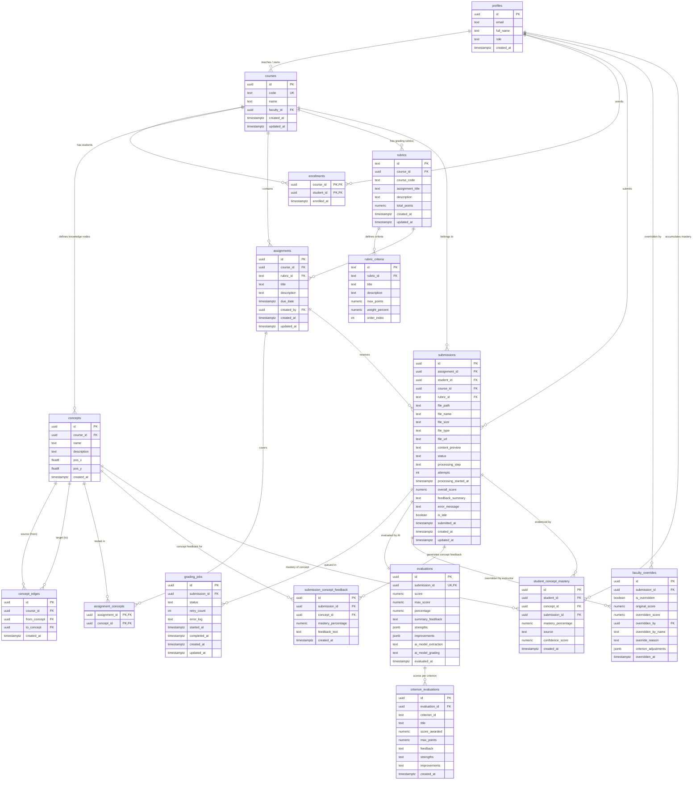

# Day 1 Authoritative Database Schema Specification

**Platform:** EduAgents – Human-AI Co-Learning Platform  
**Status:** Authoritative Design (Day 1 Milestone)  
**Database:** PostgreSQL 15+ / Supabase  

---

## 1. Schema Relationship Diagram (Mermaid)



---

## 2. Entity Dictionary & Detailed Field Definitions

### 2.1 Identity & Access
#### `public.profiles`
Mirrors Supabase Auth users with role and profile metadata.
- `id` (`UUID`, PK): References `auth.users(id)` ON DELETE CASCADE.
- `email` (`TEXT`, NOT NULL): User's authenticated email address.
- `full_name` (`TEXT`): User's display name.
- `role` (`TEXT`, NOT NULL, DEFAULT `'student'`): Role constraint: `CHECK (role IN ('student', 'faculty', 'admin'))`.
- `created_at` (`TIMESTAMPTZ`, DEFAULT `now()`): Account registration timestamp.

### 2.2 Academic Organization
#### `public.courses`
Represents an academic course offering.
- `id` (`UUID`, PK, DEFAULT `gen_random_uuid()`): Unique course identifier.
- `code` (`TEXT`, NOT NULL, UNIQUE): Unique human-readable code (e.g., `'CS101'`, `'AI301'`).
- `name` (`TEXT`, NOT NULL): Full course name (e.g., `"Data Structures & Algorithms"`).
- `faculty_id` (`UUID`, NOT NULL): References `public.profiles(id)` ON DELETE RESTRICT. The instructor owning the course.
- `created_at` (`TIMESTAMPTZ`, DEFAULT `now()`).
- `updated_at` (`TIMESTAMPTZ`, DEFAULT `now()`).

#### `public.enrollments`
Represents student registration in a course.
- `course_id` (`UUID`, NOT NULL): References `public.courses(id)` ON DELETE CASCADE.
- `student_id` (`UUID`, NOT NULL): References `public.profiles(id)` ON DELETE CASCADE.
- `enrolled_at` (`TIMESTAMPTZ`, DEFAULT `now()`).
- Primary Key: `(course_id, student_id)` — Prevents duplicate enrollments.

### 2.3 Knowledge Graph (Curriculum DAG)
#### `public.concepts`
Represents a distinct learning concept or skill node within a course.
- `id` (`UUID`, PK, DEFAULT `gen_random_uuid()`).
- `course_id` (`UUID`, NOT NULL): References `public.courses(id)` ON DELETE CASCADE.
- `name` (`TEXT`, NOT NULL): Concept title (e.g., `"QuickSort Partitioning"`, `"Recurrence Relations"`).
- `description` (`TEXT`): Detailed pedagogical objective.
- `pos_x` (`FLOAT8`, DEFAULT `0.0`): X coordinate for canvas/graph layout rendering.
- `pos_y` (`FLOAT8`, DEFAULT `0.0`): Y coordinate for canvas/graph layout rendering.
- `created_at` (`TIMESTAMPTZ`, DEFAULT `now()`).

#### `public.concept_edges`
Represents a directed prerequisite relationship between two concepts in the same course (`from_concept` is prerequisite for `to_concept`).
- `id` (`UUID`, PK, DEFAULT `gen_random_uuid()`).
- `course_id` (`UUID`, NOT NULL): References `public.courses(id)` ON DELETE CASCADE.
- `from_concept` (`UUID`, NOT NULL): References `public.concepts(id)` ON DELETE CASCADE.
- `to_concept` (`UUID`, NOT NULL): References `public.concepts(id)` ON DELETE CASCADE.
- `created_at` (`TIMESTAMPTZ`, DEFAULT `now()`).
- Constraints:
  - `CHECK (from_concept <> to_concept)`: Prevents self-loops.
  - `UNIQUE (from_concept, to_concept)`: Prevents duplicate edges.
  - Trigger `trg_prevent_concept_edge_cycles`: Prevents cycles using recursive CTE ancestor check.

### 2.4 Assignments & Rubrics
#### `public.rubrics`
Structured grading guidelines created by faculty.
- `id` (`TEXT`, PK): String identifier (e.g. `'rubric-1'` or UUID string).
- `course_id` (`UUID`): References `public.courses(id)` ON DELETE CASCADE.
- `course_code` (`TEXT`, NOT NULL): Denormalized course code for query compatibility.
- `assignment_title` (`TEXT`, NOT NULL): Title of the assignment this rubric grades.
- `description` (`TEXT`, DEFAULT `''`).
- `total_points` (`NUMERIC`, NOT NULL, DEFAULT `100.0`, `CHECK (total_points > 0)`).
- `created_at` (`TIMESTAMPTZ`, DEFAULT `now()`).
- `updated_at` (`TIMESTAMPTZ`, DEFAULT `now()`).

#### `public.rubric_criteria`
Individual weighted criteria within a rubric.
- `id` (`TEXT`, PK): e.g. `'crit-1'`.
- `rubric_id` (`TEXT`, NOT NULL): References `public.rubrics(id)` ON DELETE CASCADE.
- `title` (`TEXT`, NOT NULL): Criterion title (e.g., `"Time & Space Complexity"`).
- `description` (`TEXT`, DEFAULT `''`).
- `max_points` (`NUMERIC`, NOT NULL, `CHECK (max_points >= 0)`).
- `weight_percent` (`NUMERIC`): Optional relative weight.
- `order_index` (`INT`, NOT NULL, DEFAULT `0`).

#### `public.assignments`
Curriculum assignments issued to students.
- `id` (`UUID`, PK, DEFAULT `gen_random_uuid()`).
- `course_id` (`UUID`, NOT NULL): References `public.courses(id)` ON DELETE CASCADE.
- `rubric_id` (`TEXT`): References `public.rubrics(id)` ON DELETE SET NULL.
- `title` (`TEXT`, NOT NULL).
- `description` (`TEXT`, DEFAULT `''`).
- `due_date` (`TIMESTAMPTZ`, NOT NULL).
- `created_by` (`UUID`): References `public.profiles(id)`.
- `created_at` (`TIMESTAMPTZ`, DEFAULT `now()`).
- `updated_at` (`TIMESTAMPTZ`, DEFAULT `now()`).

#### `public.assignment_concepts`
Maps assignments to the concepts they assess.
- `assignment_id` (`UUID`, NOT NULL): References `public.assignments(id)` ON DELETE CASCADE.
- `concept_id` (`UUID`, NOT NULL): References `public.concepts(id)` ON DELETE CASCADE.
- Primary Key: `(assignment_id, concept_id)`.
- Trigger `trg_check_assignment_concept_course_match`: Enforces that both `assignments.course_id` and `concepts.course_id` match.

### 2.5 Submissions & Queue Execution
#### `public.submissions`
Authoritative table for all student submissions.
- `id` (`UUID`, PK, DEFAULT `gen_random_uuid()`).
- `assignment_id` (`UUID`): References `public.assignments(id)` ON DELETE CASCADE.
- `student_id` (`UUID`, NOT NULL): References `public.profiles(id)` ON DELETE CASCADE.
- `course_id` (`UUID`): References `public.courses(id)` ON DELETE CASCADE.
- `rubric_id` (`TEXT`): References `public.rubrics(id)` ON DELETE SET NULL.
- `file_path` (`TEXT`, NOT NULL): Storage key in bucket (e.g. `"<student_id>/<sub_id>/hw.pdf"`).
- `file_name` (`TEXT`, NOT NULL).
- `file_size` (`TEXT`, NOT NULL).
- `file_type` (`TEXT`, NOT NULL, `CHECK (file_type IN ('pdf', 'markdown', 'text'))`).
- `file_url` (`TEXT`): Signed or public storage URL.
- `content_preview` (`TEXT`): Brief snippet for dashboard lists.
- `status` (`TEXT`, NOT NULL, DEFAULT `'pending'`, `CHECK (status IN ('pending', 'processing', 'graded', 'done', 'failed', 'flagged'))`).
- `processing_step` (`TEXT`, `CHECK (processing_step IN ('queued', 'extracting', 'grading', 'synced'))`).
- `attempts` (`INT`, NOT NULL, DEFAULT `1`, `CHECK (attempts >= 1)`).
- `processing_started_at` (`TIMESTAMPTZ`).
- `overall_score` (`NUMERIC`, `CHECK (overall_score IS NULL OR overall_score >= 0)`).
- `feedback_summary` (`TEXT`).
- `error_message` (`TEXT`).
- `is_late` (`BOOLEAN`, DEFAULT `false`).
- `submitted_at` (`TIMESTAMPTZ`, NOT NULL, DEFAULT `now()`).
- `created_at` (`TIMESTAMPTZ`, NOT NULL, DEFAULT `now()`).
- `updated_at` (`TIMESTAMPTZ`, NOT NULL, DEFAULT `now()`).
- Constraint: `UNIQUE (assignment_id, student_id)` — One active submission per student per assignment policy.

#### `public.grading_jobs`
Asynchronous batch processing queue drained by the 2-minute cron runner.
- `id` (`UUID`, PK, DEFAULT `gen_random_uuid()`).
- `submission_id` (`UUID`, NOT NULL): References `public.submissions(id)` ON DELETE CASCADE.
- `status` (`TEXT`, NOT NULL, DEFAULT `'pending'`, `CHECK (status IN ('pending', 'processing', 'done', 'failed', 'flagged'))`).
- `retry_count` (`INT`, NOT NULL, DEFAULT `0`, `CHECK (retry_count >= 0)`).
- `error_log` (`TEXT`).
- `started_at` (`TIMESTAMPTZ`).
- `completed_at` (`TIMESTAMPTZ`).
- `created_at` (`TIMESTAMPTZ`, NOT NULL, DEFAULT `now()`).
- `updated_at` (`TIMESTAMPTZ`, NOT NULL, DEFAULT `now()`).

### 2.6 Evaluation & Grading Results
#### `public.evaluations`
Gemini AI overall evaluation output for a submission.
- `id` (`UUID`, PK, DEFAULT `gen_random_uuid()`).
- `submission_id` (`UUID`, NOT NULL, UNIQUE): References `public.submissions(id)` ON DELETE CASCADE.
- `score` (`NUMERIC`, NOT NULL, `CHECK (score >= 0)`).
- `max_score` (`NUMERIC`, NOT NULL, DEFAULT `100.0`, `CHECK (max_score > 0)`).
- `percentage` (`NUMERIC`, NOT NULL, `CHECK (percentage BETWEEN 0 AND 100)`).
- `summary_feedback` (`TEXT`, NOT NULL, DEFAULT `''`).
- `strengths` (`JSONB`, NOT NULL, DEFAULT `'[]'::jsonb`).
- `improvements` (`JSONB`, NOT NULL, DEFAULT `'[]'::jsonb`).
- `ai_model_extraction` (`TEXT`, DEFAULT `'Gemini Flash-Lite'`).
- `ai_model_grading` (`TEXT`, DEFAULT `'Gemini Flash'`).
- `evaluated_at` (`TIMESTAMPTZ`, NOT NULL, DEFAULT `now()`).

#### `public.criterion_evaluations`
Breakdown of points and qualitative feedback per rubric criterion.
- `id` (`UUID`, PK, DEFAULT `gen_random_uuid()`).
- `evaluation_id` (`UUID`, NOT NULL): References `public.evaluations(id)` ON DELETE CASCADE.
- `criterion_id` (`TEXT`, NOT NULL): Matches `rubric_criteria.id`.
- `title` (`TEXT`, NOT NULL, DEFAULT `''`).
- `score_awarded` (`NUMERIC`, NOT NULL, `CHECK (score_awarded >= 0)`).
- `max_points` (`NUMERIC`, NOT NULL, `CHECK (max_points >= 0)`).
- `feedback` (`TEXT`, NOT NULL, DEFAULT `''`).
- `strengths` (`TEXT`).
- `improvements` (`TEXT`).
- `created_at` (`TIMESTAMPTZ`, DEFAULT `now()`).

### 2.7 Concept Mastery & Learning Progress
#### `public.submission_concept_feedback`
AI-generated concept-level assessment and feedback for a submission.
- `id` (`UUID`, PK, DEFAULT `gen_random_uuid()`).
- `submission_id` (`UUID`, NOT NULL): References `public.submissions(id)` ON DELETE CASCADE.
- `concept_id` (`UUID`, NOT NULL): References `public.concepts(id)` ON DELETE CASCADE.
- `mastery_percentage` (`NUMERIC`, `CHECK (mastery_percentage BETWEEN 0 AND 100)`).
- `feedback_text` (`TEXT`).
- `created_at` (`TIMESTAMPTZ`, DEFAULT `now()`).
- Constraint: `UNIQUE (submission_id, concept_id)`.

#### `public.student_concept_mastery`
Current state of a student's assessed concept mastery.
- `id` (`UUID`, PK, DEFAULT `gen_random_uuid()`).
- `student_id` (`UUID`, NOT NULL): References `public.profiles(id)` ON DELETE CASCADE.
- `concept_id` (`UUID`, NOT NULL): References `public.concepts(id)` ON DELETE CASCADE.
- `submission_id` (`UUID`): References `public.submissions(id)` ON DELETE SET NULL.
- `mastery_percentage` (`NUMERIC`, NOT NULL, `CHECK (mastery_percentage BETWEEN 0 AND 100)`).
- `source` (`TEXT`, NOT NULL, DEFAULT `'ai'`, `CHECK (source IN ('ai', 'faculty_override'))`).
- `confidence_score` (`NUMERIC`, `CHECK (confidence_score BETWEEN 0 AND 1)`).
- `created_at` (`TIMESTAMPTZ`, DEFAULT `now()`).

### 2.8 Human Oversight & Audit Trail
#### `public.faculty_overrides`
Tamper-evident log of faculty adjustments to AI evaluations.
- `id` (`UUID`, PK, DEFAULT `gen_random_uuid()`).
- `submission_id` (`UUID`, NOT NULL): References `public.submissions(id)` ON DELETE CASCADE.
- `is_overridden` (`BOOLEAN`, NOT NULL, DEFAULT `true`).
- `original_score` (`NUMERIC`, NOT NULL).
- `overridden_score` (`NUMERIC`, NOT NULL, `CHECK (overridden_score >= 0)`).
- `overridden_by` (`UUID`, NOT NULL): References `public.profiles(id)`.
- `overridden_by_name` (`TEXT`, NOT NULL).
- `override_reason` (`TEXT`, NOT NULL).
- `criterion_adjustments` (`JSONB`).
- `overridden_at` (`TIMESTAMPTZ`, NOT NULL, DEFAULT `now()`).

---

## 3. Pedagogical Mastery Calculation Design

### Distinction Between Assignment Marks & Concept Mastery
Assignment marks represent raw rubric criteria performance on a specific deliverable. Concept mastery represents an enduring assessment of a student's competence in a specific theoretical or practical concept.

```
Rubric Criterion Scores (e.g. 34/35 on Correctness, 20/25 on Proof)
                             │
                             ▼
               Assignment Concepts Mapping
           (Assignment covers Concept A [70%], Concept B [30%])
                             │
                             ▼
         Separately Calculated Concept Evidence
  • Concept A Evidence: 95% (High confidence, source: 'ai')
  • Concept B Evidence: 80% (Medium confidence, source: 'ai')
                             │
                             ▼
            student_concept_mastery Record
       (Updates student's Knowledge Graph visualization)
```

### Assumptions for MVP:
1. An assignment covers 1 to $N$ concepts defined in `assignment_concepts`.
2. When an evaluation completes, the overall percentage achieved on the assignment provides evidence for the covered concepts.
3. If faculty override the grade, a new mastery record is recorded with `source = 'faculty_override'`, preserving the prior AI evidence history.
4. Future evidence sources (e.g., quizzes, peer reviews, diagnostic questions) can insert directly into `student_concept_mastery` without altering the table schema.

---

## 4. Integrity Constraints & Business Logic Triggers

### 4.1 Concept Prerequisite DAG Cycle Prevention
Prerequisite chains must form a Directed Acyclic Graph (DAG). Self-referential or circular dependencies ($A \to B \to C \to A$) are mathematically prohibited via trigger function:

```sql
CREATE OR REPLACE FUNCTION public.check_concept_edge_cycles()
RETURNS TRIGGER
LANGUAGE plpgsql
AS $$
BEGIN
  IF NEW.from_concept = NEW.to_concept THEN
    RAISE EXCEPTION 'A concept cannot have a prerequisite edge to itself (concept_id: %).', NEW.from_concept;
  END IF;

  IF EXISTS (
    WITH RECURSIVE path AS (
      SELECT NEW.to_concept AS current_node
      UNION
      SELECT e.to_concept
      FROM public.concept_edges e
      JOIN path p ON e.from_concept = p.current_node
    )
    SELECT 1 FROM path WHERE current_node = NEW.from_concept
  ) THEN
    RAISE EXCEPTION 'Cycle detected: Adding prerequisite edge from % to % forms a circular dependency.',
      NEW.from_concept, NEW.to_concept;
  END IF;

  RETURN NEW;
END;
$$;
```

### 4.2 Assignment-Concept Course Isolation
An assignment cannot tag a concept belonging to a different course:

```sql
CREATE OR REPLACE FUNCTION public.check_assignment_concept_course_match()
RETURNS TRIGGER
LANGUAGE plpgsql
AS $$
DECLARE
  v_assignment_course UUID;
  v_concept_course UUID;
BEGIN
  SELECT course_id INTO v_assignment_course FROM public.assignments WHERE id = NEW.assignment_id;
  SELECT course_id INTO v_concept_course FROM public.concepts WHERE id = NEW.concept_id;

  IF v_assignment_course IS NULL OR v_concept_course IS NULL THEN
    RAISE EXCEPTION 'Assignment or Concept does not exist.';
  END IF;

  IF v_assignment_course <> v_concept_course THEN
    RAISE EXCEPTION 'Course mismatch: Assignment (%) belongs to course %, but Concept (%) belongs to course %.',
      NEW.assignment_id, v_assignment_course, NEW.concept_id, v_concept_course;
  END IF;

  RETURN NEW;
END;
$$;
```

---

## 5. Backward Compatibility Layer (`submissions_v2` View)

To guarantee that the existing Next.js frontend and legacy queries continue operating seamlessly without breaking changes, `public.submissions_v2` is maintained as an updatable PostgreSQL view over `public.submissions`:

```sql
CREATE OR REPLACE VIEW public.submissions_v2 AS
SELECT
  s.id::text AS id,
  COALESCE(p.id::text, s.student_id::text) AS student_id,
  COALESCE(p.full_name, 'Student') AS student_name,
  COALESCE(p.email, 'student@eduagents.app') AS student_email,
  COALESCE(s.assignment_id::text, s.rubric_id, 'assignment') AS assignment_id,
  COALESCE(a.title, r.assignment_title, 'Assignment') AS assignment_title,
  COALESCE(c.code, r.course_code, 'CS101') AS course_code,
  s.file_name,
  s.file_size,
  s.file_type,
  s.file_url,
  s.content_preview,
  s.rubric_id,
  s.status,
  s.processing_step,
  s.submitted_at,
  s.student_id AS owner_id
FROM public.submissions s
LEFT JOIN public.profiles p ON p.id = s.student_id
LEFT JOIN public.assignments a ON a.id = s.assignment_id
LEFT JOIN public.courses c ON c.id = s.course_id
LEFT JOIN public.rubrics r ON r.id = s.rubric_id;
```
